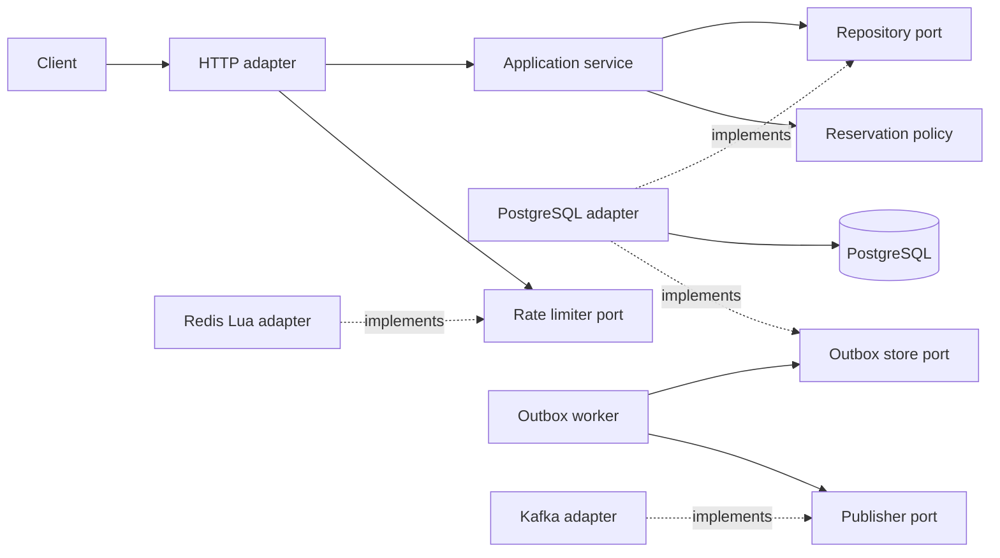
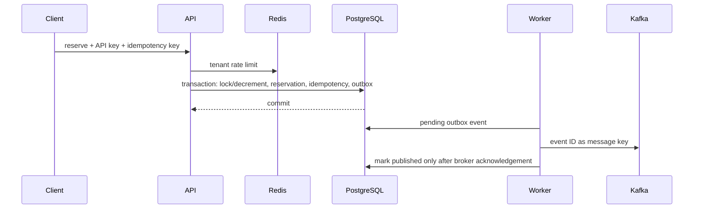
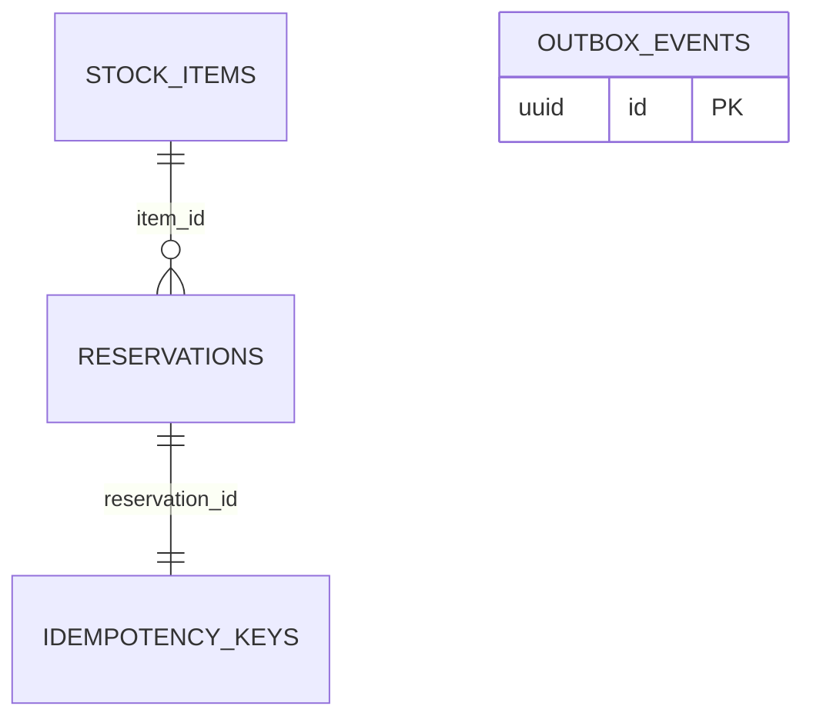

# Architecture

## Boundaries and dependency direction

Inventory is one coherent domain with two processes: HTTP API and outbox worker. The application owns repository/event contracts; PostgreSQL, Redis and Kafka implement adapters selected by the cmd composition roots. Domain policy enforces quantity and reservation-state rules without importing HTTP or database drivers. HTTP obtains tenant identity from the API-key map, never the request body.

## Transaction integrity

Reserve first claims the tenant/idempotency-key unique row with INSERT ON CONFLICT DO NOTHING. A concurrent loser waits and reads the winner's committed hash and reservation. Equal payloads replay; mismatches conflict. A tenant-scoped stock UPDATE requires available stock at least equal to the quantity. Reservation, idempotency reference and outbox event then commit together. Every failure rolls the whole transaction back.

Confirm/release locks the tenant-scoped reservation before checking the state. Two simultaneous releases cannot restore stock twice; a confirm/release race has one legal winner. The transition and its event share the same transaction. Tests use real concurrent database calls because mocks cannot prove these properties.

## Outbox semantics

Claiming atomically sets a lease token and expiry. Competing workers skip active leases. Expired leases make crashed work retryable; acknowledgement requires the same claim token. Failed publishing preserves the event, records retry timing and keeps the worker alive. One event is leased per publish so sequential batches cannot exhaust their lease while waiting.

A crash after Kafka acknowledgement but before the database acknowledgement can duplicate delivery. A timed-out send may also finish later. Delivery is explicitly **at least once**. Consumers must deduplicate by the stable event ID and protect their own side effects transactionally. No consumer or exactly-once guarantee is implied.

## SOLID mapping

| Principle | Concrete choice |
|---|---|
| Single responsibility | policy, use cases, SQL transactions, HTTP mapping and delivery lifecycle are separate |
| Open/closed | use cases consume a repository port that another adapter can implement |
| Liskov substitution | the port's semantic contract includes tenant scope, transaction integrity and replay behavior |
| Interface segregation | worker storage/publisher contracts and the HTTP limiter are separate from inventory commands |
| Dependency inversion | application owns contracts; cmd selects concrete PostgreSQL/Redis/Kafka implementations |

The modular service plus worker keeps the current invariant in one transaction. Many microservices would add distributed consistency and operations overhead without another business boundary. Kafka serves asynchronous delivery; gRPC/Kubernetes remain documented future choices, not claimed implementations. Public deployment, schema evolution and benchmarking are separate work.

